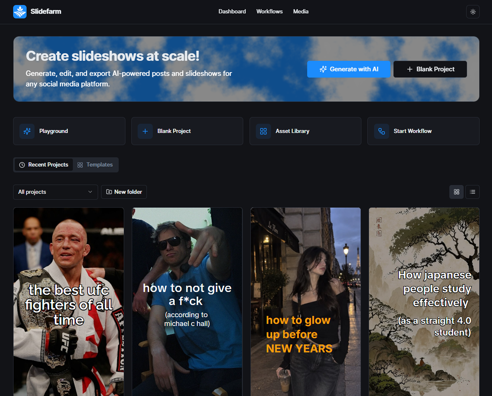
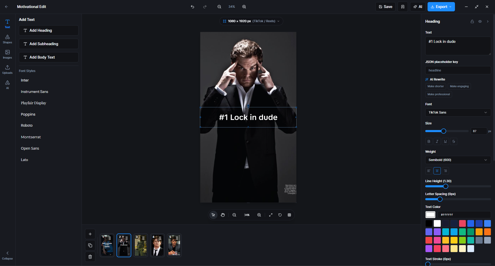
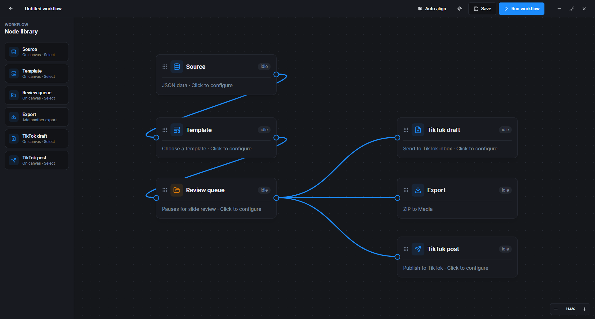

<p align="center"></p>

<h1 align="center">SlideFarm</h1>

<p align="center"><strong>Create, edit, and export social media slideshows from your desktop.</strong></p>

<p align="center">Design slides on a visual canvas, reuse your own templates, and generate content with optional AI tools. Built with Next.js, React, TypeScript, Electron, and Konva.</p>

<p align="center">
  <a href="#create-and-edit">Create and edit</a> ·
  <a href="#workflows">Workflows</a> ·
  <a href="#export">Export</a> ·
  <a href="#get-started">Get started</a> ·
  <a href="#status">Status</a> ·
  <a href="#development">Development</a>
</p>

<p align="center"></p>

SlideFarm runs as an Electron app with a local Next.js server. You can create slides without an account or API key. AI generation and TikTok sandbox posting are available when you configure their respective services.

## Create and edit

<p align="center"></p>

- **Start your way.** Create a blank project, generate slides with AI, or reuse a template you saved from an earlier project. The template gallery has no bundled starter templates yet.
- **Work on a canvas.** Add and arrange slide elements in the editor, manage multiple slides, and organize projects into folders.
- **Reuse layouts.** Save a project as a custom template and fill its text and image placeholders with new content.

## Workflows

<p align="center"></p>

Connect source, template, review, export, and TikTok steps on a visual workflow canvas. Configure each node, review slides before delivery, and run the workflow from the editor. AI workflow jobs require a server-side API key; TikTok steps require the sandbox integration described below.

## Export

| Format | Output |
| --- | --- |
| PNG or JPG | First slide |
| PDF | All slides in one document |
| ZIP | All slides as numbered PNG files |
| JSON | Project data |

Exports use the project's slide dimensions. The JSON export preserves the project structure for data transfer; image and PDF exports are rendered output.

## Get started

**Requirements:** Node.js and npm. Use a current Node.js LTS release.

```bash
npm install
npm run desktop
```

`npm run desktop` installs the Electron shell dependencies, then starts Electron and a local Next.js development server. On first launch, choose **Blank Project** or **Browse Templates**; an API key is only needed for AI features.

To run the web app by itself:

```bash
npm run dev
```

Open `http://localhost:3000`. Local file-backed features use the machine running the Next.js server, so the desktop app is the primary way to run SlideFarm.

## AI setup (optional)

SlideFarm uses an OpenAI API key for slide generation, remixing, image generation, rewriting, and captions. Create a key in the [OpenAI API dashboard](https://platform.openai.com/api-keys), then open **Settings** in SlideFarm, enter it under **OpenAI API key**, and select **Save key**. API usage is billed separately from ChatGPT. Saving a key does not validate it; if a request fails, check the key and API billing.

The key is stored in the local Electron profile and sent to SlideFarm's local server for AI requests. Anyone with access to that profile can use it. Select **Remove key** in Settings to clear it. Workflow jobs currently use the server's `OPENAI_API_KEY` environment variable instead of the key saved in Settings.

For server-side configuration, copy `.env.example` to `.env` and fill in only the values you need. Never commit real credentials. The example also lists optional model settings, TikTok, Cloudflare R2, and Pinterest variables.

## Local data

Projects and folders are stored in `projects.json` in SlideFarm's local app data directory: `%APPDATA%\SlideFarm` on Windows, `~/Library/Application Support/SlideFarm` on macOS, or `$XDG_DATA_HOME/SlideFarm` (usually `~/.local/share/SlideFarm`) on Linux. Set `SLIDEFARM_DATA_DIR` to use a different directory. Electron sets it to its user data directory when launching the server. The first local load migrates projects and folders from older browser storage.

Back up the local data directory if you need to preserve projects, templates, or connected account data. The desktop server listens on `127.0.0.1` on an available port; file and account endpoints accept localhost requests.

## TikTok sandbox (optional)

In your TikTok Developer sandbox, enable Login Kit and Content Posting API, allow `user.info.basic` and `video.publish`, and register the exact callback URL. Configure these server variables in `.env`:

```dotenv
TIKTOK_CLIENT_KEY=your-sandbox-client-key
TIKTOK_CLIENT_SECRET=your-sandbox-client-secret
TIKTOK_REDIRECT_URI=https://your-app-domain.example/api/tiktok/callback
R2_ACCOUNT_ID=your-cloudflare-account-id
R2_BUCKET=your-bucket-name
R2_ACCESS_KEY_ID=your-r2-access-key-id
R2_SECRET_ACCESS_KEY=your-r2-secret-access-key
TIKTOK_VERIFIED_URL_PREFIX=https://slides.your-domain.example
```

For a local server, an HTTPS tunnel can forward the web callback to `/api/tiktok/callback`; account management stays on localhost. For Desktop Login Kit, use a registered localhost callback such as `http://localhost:3000/api/tiktok/callback`; SlideFarm uses PKCE for that flow. To upload to the TikTok inbox, enable `video.upload` and reconnect the account.

Create an R2 bucket and an API token with object write access. Connect the bucket to a public custom domain, verify that domain for Content Posting in the TikTok sandbox, and set `TIKTOK_VERIFIED_URL_PREFIX` to its HTTPS origin. SlideFarm uploads slides to `tiktok/slides/*.png` and passes the public URLs to TikTok.

Each connected profile has its own calendar. Scheduling exports the slides to R2 immediately; the local SlideFarm server submits the post at the chosen time. Keep the server running for scheduled posts and reopen the calendar after restarting it. If you configure an R2 lifecycle rule, retain the files until TikTok has fetched them. Connected account tokens stay in the local data directory. Sandbox posting is limited to accounts allowed in your TikTok sandbox.

## Status

SlideFarm is an early-stage project. The desktop app, canvas editor, custom templates, and export formats above are implemented. The template gallery currently has no bundled starter templates. TikTok posting targets the developer sandbox and depends on a running local server for scheduled posts. There are no prebuilt downloads documented here; build an installer from source with `npm run desktop:build`.

## Development

```bash
npm run typecheck
npm run lint
npm run build
```

`npm run desktop:build` creates a production build and a platform installer in `dist/`.

### Architecture

| Area | Location |
| --- | --- |
| Next.js pages and API routes | `app/` |
| Editor UI | `components/editor/` |
| Canvas, templates, and snapping | `lib/canvas/` |
| Export rendering | `lib/export/` |
| Local data and integrations | `lib/server/` |
| Editor and project state | `stores/` |
| Shared project and element types | `types/index.ts` |
| Desktop shell | `electron/` |

See [AGENTS.md](AGENTS.md) for repository working practices. Issues and pull requests are welcome; describe the behavior you changed, keep changes focused, and run the relevant checks above.

## License

This repository does not currently include a license file. An explicit license is needed before others can reuse or redistribute the code under open source terms.
